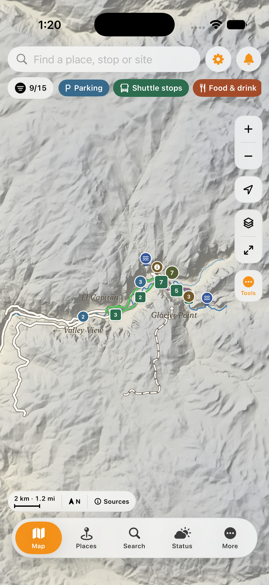
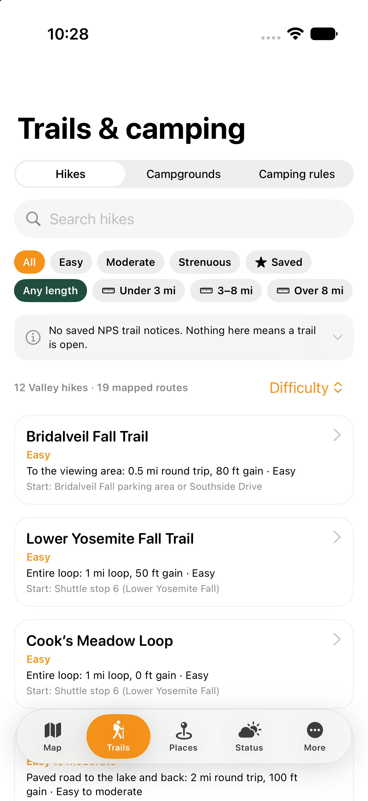
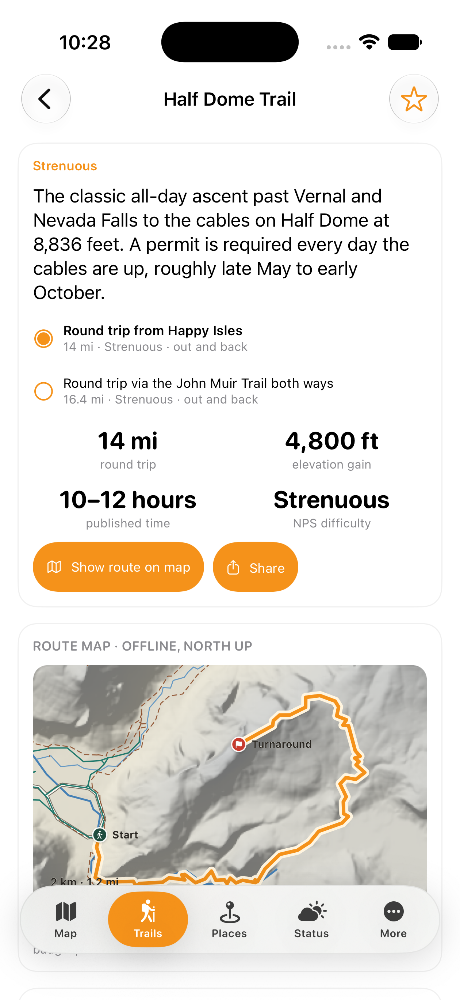
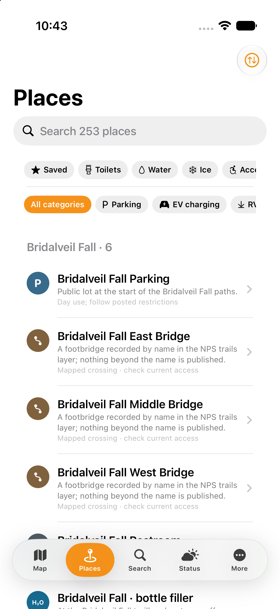
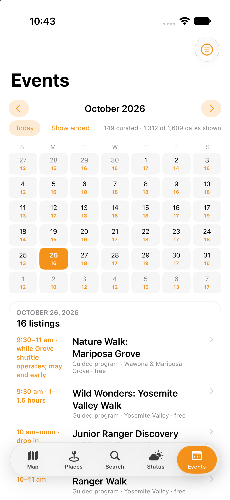
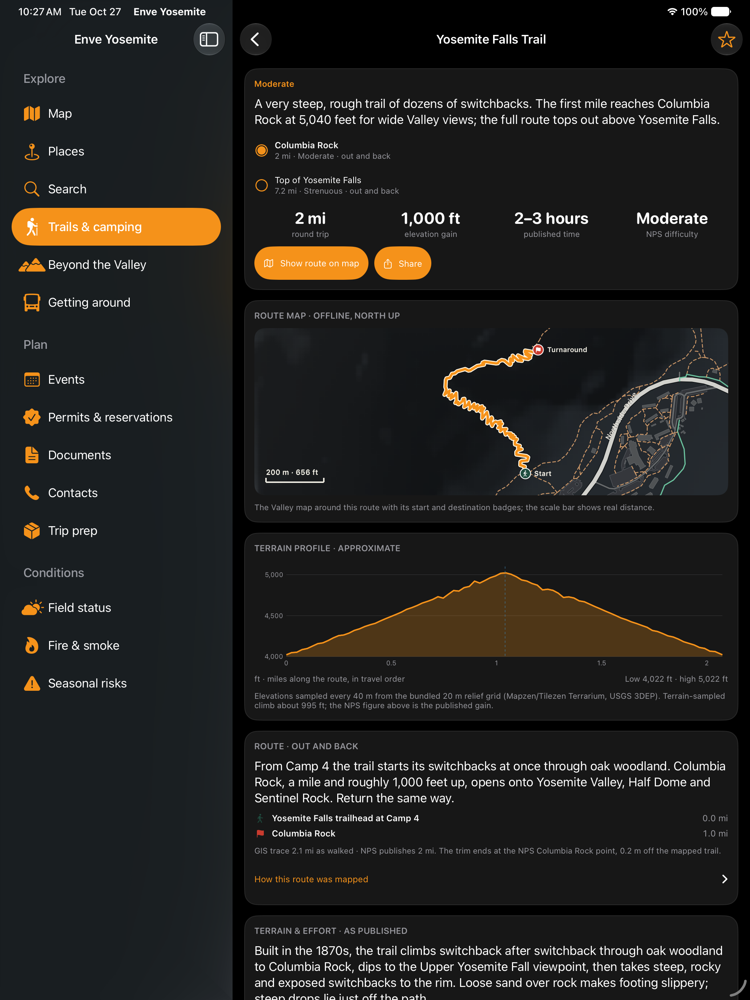

# Enve Yosemite

An offline Yosemite field guide for iPhone and iPad. Explore the Valley, compare hikes, inspect whole trail routes, and keep the practical details of a park visit in one place.

Independent project, not affiliated with or endorsed by the National Park Service.

## Screenshots

| Valley map | Hikes | Trail details |
| :---: | :---: | :---: |
|  |  |  |

| Places | Events |
| :---: | :---: |
|  |  |

**iPad:** trail details, route map and elevation profile in dark mode.



*Simulator captures from October 26–27, 2026. Navigation and the terrain inspector have since been updated.*

## Features

- **Offline maps:** locally rendered roads, trails, buildings, waterways, campsites, shaded relief and contours, with search, category filters and source attribution.
- **Hiking:** 12 hikes and 19 route variants, whole-route highlighting, focused map mode, landmarks, published distance and gain, approximate terrain profiles, and linked map/profile inspection.
- **Places and camping:** searchable facilities, water and ice, numbered campsites, accessibility notes, contacts and official links.
- **Trip planning:** offline shuttle schedules, events, permit guides, park regions and five bundled NPS documents.
- **Personal records:** saved places, notes, parked car and campsite, plus backup export/import. Personal records stay on the device.
- **Optional live conditions:** an operator-run companion server supplies weather, fire, smoke, road notices and NPS programs. Feeds show their source dates and unavailable or expired states.

The app supports light and dark appearance, Dynamic Type, VoiceOver and adaptive iPad layouts. See [feature status and limitations](docs/PARITY.md) for details.

## Build

Requires macOS, Xcode 27.1 (the verified version) and [XcodeGen](https://github.com/yonaskolb/XcodeGen). The deployment target is iOS 17. No third-party Swift packages are required.

```sh
cd ios
xcodegen generate
open EnveYosemite.xcodeproj
```

Choose the **EnveYosemite** scheme and an iPhone or iPad simulator in Xcode, then run. All base maps, content and documents are included; the reference website and companion server are not required to launch or use the offline guide.

To build from the repository root:

```sh
TOOLCHAINS=com.apple.dt.toolchain.XcodeDefault xcodebuild \
  -project ios/EnveYosemite.xcodeproj -scheme EnveYosemite \
  -destination 'platform=iOS Simulator,name=iPhone Air' \
  -derivedDataPath build/DerivedData CODE_SIGNING_ALLOWED=NO build
```

For a physical device, select your development team in Xcode and use a provisioning profile that supports the app's push entitlement. Push also requires separately configured server credentials. Signing credentials and profiles are not included.

The internal target, module and source folder remain `PettyFieldGuide`, and the bundle identifier remains `dev.petty.fieldguide`, to preserve existing installations and saved data. Public links use `enveyosemite://`; legacy `pettyfieldguide://` links still open.

## Test

Use **Product → Test** in Xcode, or replace `build` with `test` in the command above. Server tests require Node.js 22 or later:

```sh
cd server
npm run check
```

See [verification](VERIFICATION.md) for tested configurations and limits.

## Companion server

The dependency-free Node.js server is optional. Copy `server/.env.example` to `server/.env`, configure the feeds you want, and run `npm start` from `server/`. Enter its address in the app's conditions-server setting. Some providers require API keys; APNs requires an Apple developer configuration.

[Server setup and endpoints](server/README.md)

## Source layout

| Directory | Contents |
|---|---|
| `ios/` | SwiftUI app, Core Graphics map renderer, bundled resources and XCTest suite |
| `server/` | Optional condition feeds, GIS pack hosting, feedback and push support |
| `content/` | Wording overlays and ordered hike-route definitions |
| `tools/` | Data validation, route generation, terrain preparation and icon drawing |
| `docs/` | Architecture, feature status, data attribution and route atlas |

## Data and attribution

Map and guide records retain their source URLs, snapshot dates and accuracy notes. Terrain profiles and mapped distances are approximate; they remain separate from published NPS figures. Conditions and historical records do not establish that a trail or facility is open today.

[NPS, USGS, Mapzen/Tilezen, OpenStreetMap and other source credits](docs/SOURCES.md) are retained with their respective terms. Third-party data and publications are not relicensed as app code. No protection is claimed in original U.S. Government works.

## License

Enve Yosemite’s original source code is licensed under the [GNU Affero General Public License v3.0 only](LICENSE.md) (`AGPL-3.0-only`). Bundled data and publications retain the separate terms listed in [source attribution](docs/SOURCES.md).
